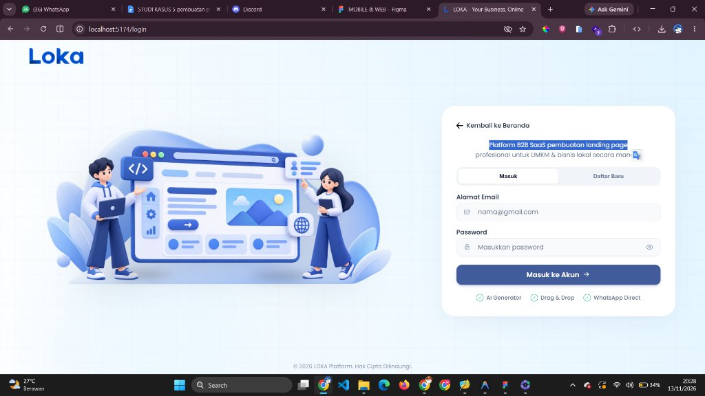
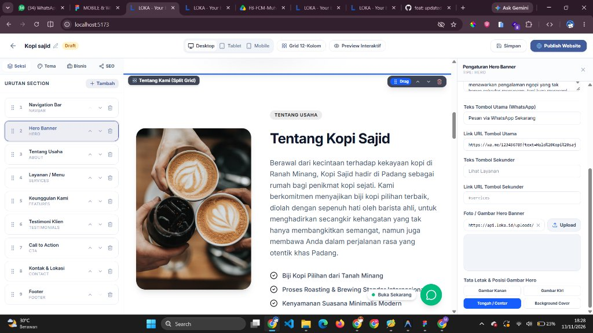
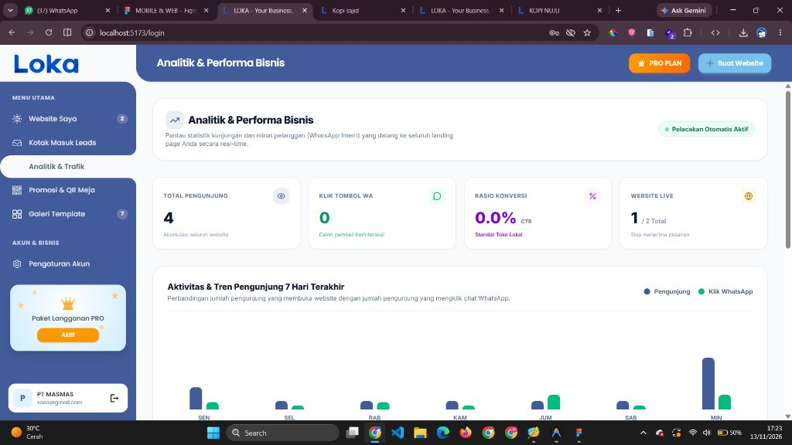
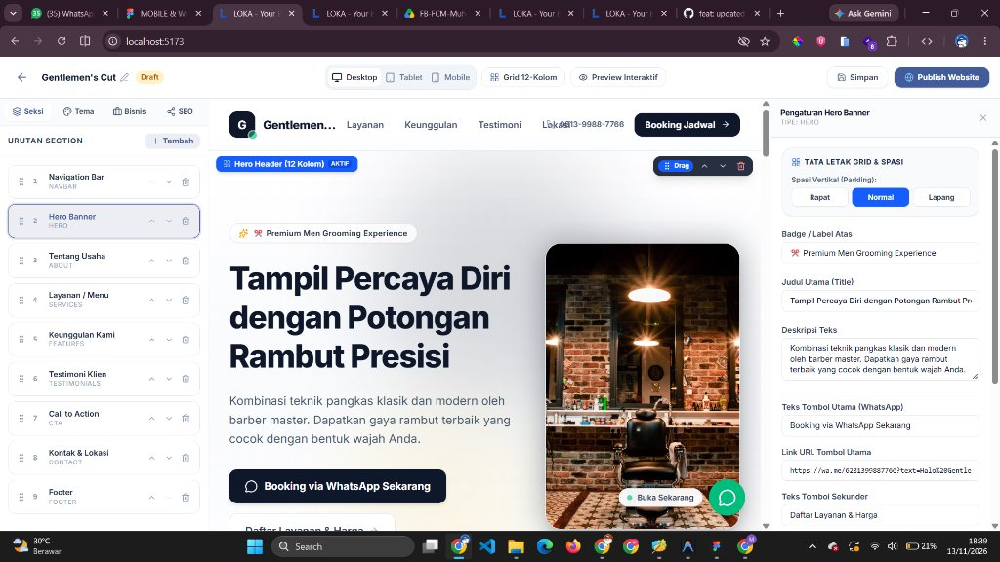
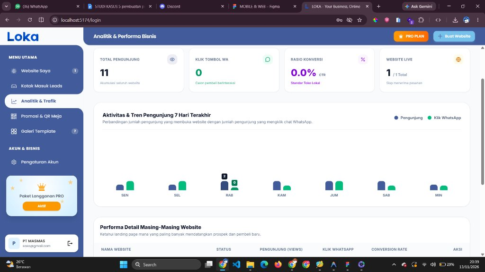
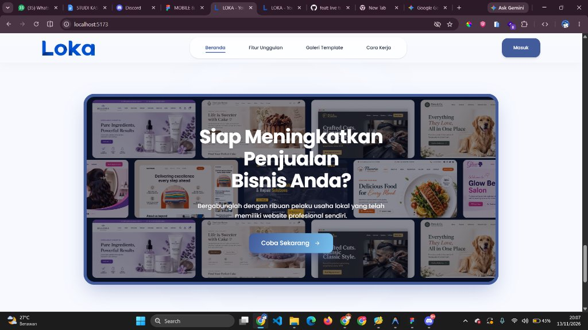

# 🌐 LOKA — Platform Pembuatan Website & Landing Page Instan UMKM

> **Solusi All-in-One No-Code Website Builder & Lead Generation untuk Bisnis Lokal Indonesia.**

[](https://react.dev/)
[](https://www.typescriptlang.org/)
[](https://vitejs.dev/)
[](https://tailwindcss.com/)

---

## 📌 Tentang Project

**Loka** adalah platform B2B SaaS (*Software as a Service*) yang dirancang khusus untuk mempermudah pelaku UMKM (*Usaha Mikro, Kecil, dan Menengah*) serta bisnis lokal di Indonesia memiliki website profil dan katalog digital profesional dalam hitungan menit tanpa keahlian koding.

Dengan antarmuka ramah pengguna (*beginner-friendly*), pemilik usaha seperti kedai kopi, barbershop, klinik kecantikan, laundry, hingga restoran dapat:
1. Memilih template desain modern yang relevan dengan sektor bisnisnya.
2. Mengkustomisasi teks, foto, jam operasional, dan daftar layanan melalui editor visual interaktif.
3. Menghubungkan tombol pemesanan langsung ke **WhatsApp** bisnis pemilik usaha (*Direct Lead Generation*).
4. Menghasilkan stand **QR Code siap cetak** untuk meja kasir/meja kafe.
5. Memantau efektivitas promosi melalui dashboard analitik pengunjung secara *real-time*.

---

## 🗺️ Alur Kerja Sistem (Workflow)

Alur kerja Loka didesain sederhana dan intuitif mulai dari pendaftaran hingga website siap menerima pesanan:

```
[ Registrasi / Login ]
         │
         ▼
[ Dashboard Merchant ] ────► [ Panduan Interaktif (Tour Guide) ]
         │
         ▼
[ Pilih Template / Buat Website ]
         │
         ▼
[ Visual Editor No-Code ] ──► (Edit Teks, Foto, Tema, Tombol WA)
         │
         ▼
[ Publikasi Website (Publish) ]
         │
         ├─────────────────────────────────┐
         ▼                                 ▼
[ Generator QR Stand Kasir ]    [ Analitik & Trafik Bisnis ]
```

---

## 📸 Dokumentasi Layar & Fitur Utama

Berikut adalah tampilan menu utama sistem yang menggambarkan alur penggunaan platform Loka:

### 1. Autentikasi Pengguna (Login & Register)
Pintu masuk merchant untuk mengelola seluruh ekosistem bisnis digital mereka dengan aman dan cepat.


---

### 2. Panduan Interaktif Pengguna Baru (*Onboarding Guide*)
Sistem pemandu cerdas langkah demi langkah (*walkthrough tour*) yang otomatis menyambut pengguna saat pertama kali masuk agar tidak bingung memahami menu sistem. Pengguna juga dapat memutar kembali panduan ini kapan saja melalui tombol **"Lihat Tutorial"**.


---

### 3. Dashboard Merchant ("Website Saya")
Pusat kontrol terpadu untuk melihat portofolio landing page yang dimiliki, status website (*Draft* / *Live*), link publikasi cepat, serta akses ke menu leads dan promosi.


---

### 4. Visual Editor No-Code (WYSIWYG Builder)
Editor berbasis blok seksi dengan sistem tata letak *split-grid* responsif. Merchant dapat mengubah judul, narasi bisnis, foto produk/banner, hingga menghubungkan format pesan otomatis WhatsApp hanya dengan mengisi form di panel kanan secara instan (*Live Preview*).


---

### 5. Laporan Analitik & Trafik Bisnis
Layar visualisasi metrik performa bisnis yang menampilkan data jumlah pengunjung (*views*), interaksi tombol WhatsApp (*leads*), serta rasio konversi (*CTR*) yang dilengkapi animasi grafik batang interaktif harian.


---

### 6. Landing Page & Galeri Template
Halaman depan publik Loka yang menampilkan ragam pilihan template website UMKM lokal (Kuliner, Jasa, Barbershop, Skincare, Pet Care) dan ajakan bergabung bagi para pelaku usaha.


---

## ✨ Fitur-Fitur Unggulan

| Fitur | Deskripsi |
|---|---|
| **🎨 Visual No-Code Editor** | Pengaturan urutan seksi, tata letak konten, foto, dan warna brand secara *drag-and-drop* tanpa sentuhan kode teknis. |
| **💬 WhatsApp Direct Order** | Mengarahkan calon pembeli langsung ke chat WhatsApp kasir/pemilik toko dengan pesan otomatis (*pre-filled message*). |
| **📱 QR Meja & Kasir Instan** | Pembuatan QR Code otomatis yang dapat langsung diunduh dan dicetak untuk ditempel pada meja kafe atau kasir. |
| **📊 Dashboard Analitik Real-Time** | Memonitor tren traffic mingguan, rasio pengunjung ke pesanan, dan ranking performa website usaha. |
| **🧭 Step-by-Step Interactive Guide** | Fitur tutorial terintegrasi di Dashboard dan Editor untuk memandu UMKM pemula hingga mahir. |
| **🔒 Validasi Status Publikasi** | Halaman ramah pengguna (*not-published state*) bila tautan diakses publik saat website masih berstatus draf. |
| **👑 Paket Langganan PRO** | Opsi upgrade untuk membuka batas pembuatan website tak terbatas dan fitur analitik mendalam. |

---

## 🛠️ Tech Stack

- **Framework**: [React 18](https://react.dev/) + [TypeScript](https://www.typescriptlang.org/)
- **Build Tool**: [Vite](https://vitejs.dev/)
- **CSS Framework**: [Tailwind CSS v4](https://tailwindcss.com/)
- **Icons**: [Lucide React](https://lucide.dev/)
- **Typography**: Poppins & Inter Google Fonts
- **Storage/State**: React Context API + LocalStorage state persistence

---

## 🚀 Panduan Memulai (Quick Start)

### Prasyarat
- Node.js versi 18 atau lebih baru
- NPM atau PNPM

### Langkah Instalasi
```bash
# 1. Pindah ke direktori frontend
cd frontend

# 2. Pasang dependensi project
npm install

# 3. Jalankan server pengembangan lokal
npm run dev
```

Aplikasi frontend akan aktif di `http://localhost:5173/` (atau port alternatif seperti `http://localhost:5174/`).

### Perintah Build Produksi
```bash
# Menjalankan type-check dan build bundle produksi
npm run build

# Menjalankan preview dari hasil build dist
npm run preview
```

---

<p align="center">
  Dibuat dengan ❤️ untuk memajukan UMKM & Bisnis Lokal Indonesia.<br>
  <b>© 2026 LOKA Platform. Hak Cipta Dilindungi.</b>
</p>
